# AutoFill v1.5 — עיצוב מחדש של הממשק

_תאריך: 2026-10-21 · גרסה: 1.5.0 · ענף: `ccr-37870d3f-r09fyh`_

המסמך מתעד את כל העבודה על העיצוב החדש: האפיון (כל שאלה שנשאלה, התשובה והחלופות שנדחו), מערכת העיצוב,
האפיון של כל מסך, שינויי הלוגיקה, השינויים בקוד לפי קובץ, הבדיקות שהורצו והמגבלות הידועות.

המסמכים הטכניים הקבועים (`CLAUDE.md`, `ARCHITECTURE.md`, `PROJECT_MAP.md`, `CHANGELOG.md`, `DECISIONS.md`) עודכנו גם הם.
המסמך הזה הוא התמונה המלאה של הגרסה.

---

## תוכן

1. [מטרה](#1-מטרה)
2. [תהליך האפיון: שאלות ותשובות](#2-תהליך-האפיון-שאלות-ותשובות)
3. [מערכת העיצוב](#3-מערכת-העיצוב)
4. [אפיון לפי מסך](#4-אפיון-לפי-מסך)
5. [שינויי לוגיקה (התנהגות)](#5-שינויי-לוגיקה-התנהגות)
6. [שינויי קוד לפי קובץ](#6-שינויי-קוד-לפי-קובץ)
7. [בדיקות](#7-בדיקות)
8. [מגבלות ידועות ומה לא נבדק](#8-מגבלות-ידועות-ומה-לא-נבדק)
9. [מדריך תחזוקה: איך משנים](#9-מדריך-תחזוקה-איך-משנים)

---

## 1. מטרה

לקחת את התוסף (MV3, עברית/RTL, בלי שלב build) ולהביא את **הממשק והעיצוב** לרמה שמתאימה לשחרור:
נוח, ברור ומעוצב, בסגנון נקי ופשוט ("סטייל 2026") ולא בעיצוב ה-AI הגנרי (גרדיאנטים, אימוג'י, כחול ברירת מחדל).
ביקשת שכל שינוי בממשק או בלוגיקה ייסגר מראש בשאלות, ולכן כל החלטה כאן נשענת על תשובה שלך.

היקף העבודה כולל שלושה מסכים:

| מסך | איפה מופיע | קובץ |
|-----|-----------|------|
| רשימת ההצעות (dropdown) | מתחת לשדה, בכל אתר | `content/dropdown.js` |
| חלון הוספת מילוי (popover) + רשימת השמורים לשדה | ליד השדה, בכל אתר | `content/config-panel.js` |
| מסך הניהול | לשונית של התוסף | `manager/*` |

ובנוסף: אייקון התוסף, ערכת אייקונים משותפת ופונט.

---

## 2. תהליך האפיון: שאלות ותשובות

השאלות נשאלו בארבעה סבבים. ✅ מסמן את התשובה שנבחרה. החלופות שנדחו מופיעות כדי שיהיה ברור למה המצב הוא כפי שהוא.

### סבב 1: כיוון עיצובי

| # | שאלה | ✅ נבחר | נדחו |
|---|------|--------|------|
| 1 | כיוון עיצובי כללי | **מינימליסטי ניטרלי**: רקעים לבנים/אפורים עדינים, גבולות 1px, צבע הדגשה אחד רק לפעולות ראשיות (ברוח Linear / Raycast / Vercel) | רך ומעוגל (פסטלים, צללים רכים); צפוף ומקצועי (טבלה צפופה) |
| 2 | מצב תאורה | **אוטומטי לפי המערכת** (`prefers-color-scheme`), בכל המסכים | אוטומטי + מתג ידני; בהיר בלבד |
| 3 | צבע הדגשה | **שחור/ניטרלי** (בכהה: לבן). צבע מופיע רק לסטטוסים (ירוק "ייחודי", אדום מחיקה) | כחול-אינדיגו; ירוק-טורקיז; כתום-ענבר |
| 4 | אימוג'י | **החלפה באייקוני SVG דקים**: סט אחד בקו דק, מוטמע בקוד, בלי ספריות | להשאיר אימוג'י; בלי אייקונים |

### סבב 2: מבנה מסך הניהול

| # | שאלה | ✅ נבחר | נדחו |
|---|------|--------|------|
| 5 | מבנה העמוד | **סרגל צד + תוכן**: בסרגל "מילויים" / "קיצורי טקסט" / "גיבוי" ומתחתם רשימת אתרים לסינון. במסך צר הסרגל הופך לשורה עליונה | עמודה אחת עם לשוניות; להשאיר את המבנה |
| 6 | עריכת מילוי | **עריכה בתוך השורה** (כמו קודם, עם עיצוב ומעבר משופרים) | מגירה צדדית |
| 7 | קיבוץ הרשימה | **לפי שדה, עם סינון נוח לפי אתרים** (תשובה חופשית שלך). מומש כקיבוץ לפי שדה ורשימת "סינון לפי אתר" בסרגל הצד | לפי אתר ואז שדה; רשימה שטוחה |
| 8 | פונט | **פונט מוטמע (Rubik) במנהל**. בתוך אתרים נשארים עם פונט המערכת כדי לא להכביד על דפים של אחרים | פונט מערכת בלבד |

### סבב 3: המסכים שבתוך האתרים

| # | שאלה | ✅ נבחר | נדחו |
|---|------|--------|------|
| 9 | מיקום חלון ההוספה | **פופאובר צמוד לשדה** (במסך צר: באמצע) | חלון מרכזי (כמו קודם); פאנל צדדי |
| 10 | שדות בחלון ההוספה | **ערך + שם גלויים, השאר מקופל**: ההיקף בשורה אחת עם ברירת מחדל "האתר הזה", ושם השדה וה-selector תחת "מתקדם" | כל השדות גלויים (כמו קודם) |
| 11 | תוספות לרשימת ההצעות (בחירה מרובה) | **רמזי מקלדת בתחתית** · **הדגשת החלק המוקלד בקיצורים** · **הפריט הראשון מסומן מראש** | אייקון היקף לכל פריט |
| 12 | לחיצה על אייקון התוסף | **להשאיר**: פותח את המנהל בלשונית, מסונן לאתר הנוכחי | פופאפ קטן |

### סבב 4: פרטים

| # | שאלה | ✅ נבחר | נדחו |
|---|------|--------|------|
| 13 | אייקון התוסף | **אייקון מינימלי חדש** (ריבוע מעוגל שחור עם סמל טקסט + סמן) | להשאיר את הקיים |
| 14 | חלון "המילויים השמורים לשדה" | **להשאיר עם עריכה**. מומש כתצוגה בתוך אותו פופאובר (לא חלון על חלון) | רשימה קומפקטית בלי עריכה; להסיר |
| 15 | תוספות למנהל (בחירה מרובה) | **העתקת ערך בלחיצה** | מסכי ריקנות מפורטים; קיצורי מקלדת; מונה לכל אתר |

> הערה בשקיפות: לא בחרת "מסכי ריקנות" ו"מונה לכל אתר" כתוספות נפרדות. נשאר מסך ריקנות **מינימלי**
> (אייקון, כותרת ושורה אחת), כי רשימה ריקה לגמרי נראית שבורה. המספרים ליד כל אתר הם חלק טבעי מרשימת האתרים בסרגל,
> כמו המספרים שהיו על הצ'יפים בגרסה הקודמת. אם תרצה, שניהם מוסרים בשורה אחת של CSS (ראה §9).

---

## 3. מערכת העיצוב

### 3.1 עקרונות

1. **ניטרלי קודם כל.** אפורים של zinc, שחור/לבן כצבע פעולה. צבע אמיתי רק לסטטוס (ירוק = תקין, ענבר = אזהרה, אדום = מחיקה).
2. **קווים במקום קופסאות.** גבול 1px בגוון שקוף, צל כמעט בלתי נראה. צל עמוק רק לשכבות צפות (dropdown, popover, toast, עורך פתוח).
3. **היררכיה בטיפוגרפיה ולא בצבע.** כותרת 600, טקסט 400/500, ערכים טכניים בגופן מונו מושתק.
4. **פעולות משניות מופיעות לפי הקשר.** כפתורי העתקה/עריכה/מחיקה מופיעים ב-hover או ב-focus (במסך צר תמיד).
5. **אין אימוג'י בממשק.** כל אייקון מגיע מ-`content/icons.js`.
6. **נגישות.** טבעת focus גלויה (`box-shadow` 3px), `aria-label` לכל כפתור אייקון, `role="dialog"` לפופאובר, `aria-live` לטוסטים, ו-`prefers-reduced-motion` מבטל אנימציות.

### 3.2 טוקנים (מסך הניהול, `manager/manager.css` → `:root`)

| טוקן | בהיר | כהה | שימוש |
|------|------|-----|-------|
| `--bg` | `#fafafa` | `#0c0c0e` | רקע העמוד והסרגל |
| `--surface` | `#ffffff` | `#141417` | כרטיסים, שדות קלט |
| `--surface-2` | `#f4f4f5` | `#1c1c20` | תגיות היקף, `code`, רקע אייקון |
| `--line` | `#e9e9ec` | `#232328` | קווי הפרדה וגבולות כרטיסים |
| `--line-strong` | `#dcdce0` | `#2f2f35` | גבולות שדות, מתג כבוי |
| `--text` | `#18181b` | `#fafafa` | טקסט ראשי |
| `--muted` | `#71717a` | `#a1a1aa` | טקסט משני, ערכים |
| `--subtle` | `#a1a1aa` | `#6b6b74` | מונים, placeholders, אייקונים במנוחה |
| `--hover` / `--active` | `#f4f4f5` / `#ececee` | `#1c1c20` / `#232328` | ריחוף / פריט נבחר בסרגל |
| `--accent` / `--accent-fg` | `#18181b` / `#fff` | `#fafafa` / `#0c0c0e` | כפתור ראשי, מתג דלוק, פס עורך |
| `--ring` | שחור 12% | לבן 14% | טבעת focus |
| `--danger` / `--danger-bg` | `#dc2626` / `#fef2f2` | `#f87171` / אדום 10% | מחיקה |
| `--ok` | `#15803d` | `#4ade80` | "הועתק", "ייחודי" |

המסכים שבתוך אתרים (Shadow DOM) מגדירים את אותם ערכים כמשתנים מקומיים על `.af-drop` / `.af-pop`, עם `@media (prefers-color-scheme: dark)` משלהם.
המשתנים לא דולפים לדף המארח ולא מושפעים ממנו (`:host { all: initial }`).

### 3.3 טיפוגרפיה

| רכיב | גופן | גודל / משקל |
|------|------|------------|
| מנהל, כל הטקסט | **Rubik** (variable, ‏300–900), נטען מקומית מ-`manager/fonts/` | בסיס 14px/1.5 |
| כותרת מסך (h1) | Rubik | 22px / 600, ריווח אותיות ‎-0.02em |
| כותרת קבוצה | Rubik | 13.5px / 600 |
| שם מילוי | Rubik | 14px / 500 |
| ערך, selector, קיצור | `ui-monospace, SF Mono, Cascadia Code, Consolas` | ‏12.5–13px |
| בתוך אתרים | `system-ui` | ‏13px |

הפונט מחולק לשני קבצים עם `unicode-range` (עברית ‏8.7KB, לטינית ‏35KB), כך שהדפדפן טוען רק את מה שצריך.
רישיון SIL OFL 1.1 נמצא ב-`manager/fonts/OFL.txt`.

### 3.4 מידות

- **רדיוסים:** כרטיס 12px · popover ‏14px · שדה/כפתור 8px · כפתור אייקון 7px · תגית/מתג גלולה מלאה.
- **גבהים:** כפתור 34px (בפופאובר 32) · שדה 36px (בפופאובר 34) · שורת מילוי מינימום 58px · פריט בסרגל 34px.
- **ריווח:** עמוד 36/48px · בין קבוצות 28px · בתוך עורך 14–18px.
- **צללים:** `--shadow-sm` (כמעט אפס) לכרטיסים; `--shadow-lg` לשכבות צפות. במצב כהה הצל של כרטיסים מבוטל וההפרדה נעשית בקווים.
- **אנימציה:** כניסה עדינה של 120–180ms (שקיפות + תזוזה של 2–6px). מעברי צבע 120ms. כולם מתבטלים ב-`prefers-reduced-motion`.

### 3.5 אייקונים

סט אחד ב-`content/icons.js` (`window.__afIcons`): ‏22 צורות בסגנון Lucide, רשת 24×24, קו 1.75, `stroke="currentColor"`.
אותו קובץ נטען גם כ-content script וגם בדף המנהל, כך שיש מקור אחד לכל האייקונים.

| שם | שימוש | שם | שימוש |
|----|-------|----|-------|
| `field` | ניווט: מילויים | `globe` | היקף: כל האתרים |
| `zap` | ניווט: קיצורים | `site` | היקף: אתר מסוים |
| `archive` | ניווט: גיבוי | `link` | היקף: כתובת מכילה |
| `layers` | סינון: הכל | `pin` | סינון: הדף הנוכחי |
| `search`, `plus`, `pencil`, `trash`, `copy`, `check`, `x` | פעולות | `chevron`, `back`, `list`, `external` | ניווט פנימי |
| `download` / `upload` | גיבוי | `logo` | הלוגו בסרגל |

### 3.6 אייקון התוסף

ריבוע מעוגל (rx 6.5 מתוך 24) בצבע `#18181b`, ובתוכו בלבן שתי שורות טקסט (ארוכה וקצרה) וסמן אנכי, כלומר "טקסט שמתמלא".
המקור הוא `icons/logo.svg`, והוא רונדר ב-Chromium ל-PNG בגדלים 16/32/48/128 (`icons/icon-*.png`).
`icon.png` הישן (‏360×278, לא ריבועי) נמחק.

---

## 4. אפיון לפי מסך

### 4.1 רשימת ההצעות (dropdown)

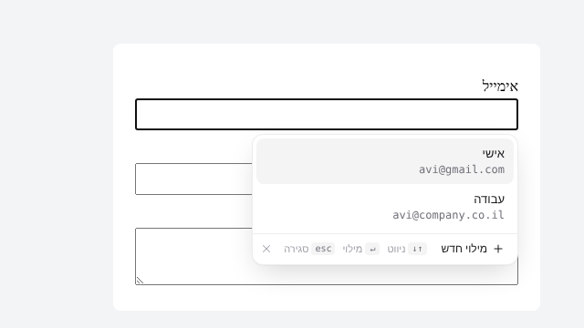 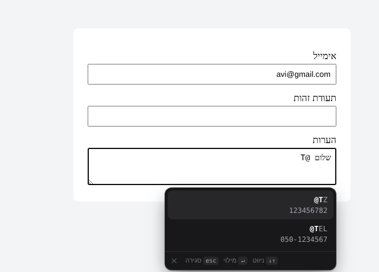

| אלמנט | אפיון |
|-------|-------|
| מיכל | כרטיס צף 288–360px, רדיוס 12, גבול שקוף, צל עמוק, אנימציית כניסה 120ms. ממוקם מתחת לשדה, עולה מעליו כשאין מקום, נצמד לגבולות המסך, ומיושר לימין בשדה RTL |
| פריט עם שם | שם (13px/500) ומתחתיו הערך במונו מושתק |
| פריט בלי שם | הערך בלבד (13px) |
| פריט קיצור | הקיצור במונו, **החלק שכבר הוקלד מודגש** (`opts.highlight`), ומתחתיו הטקסט שיוכנס |
| סימון | **הפריט הראשון מסומן מראש**. מעבר עכבר וחיצים מזיזים את אותו סימון (אין שני מצבים מתחרים) |
| גלילה | מעל כ-6 פריטים הרשימה נגללת (296px), והחיצים גוללים לפריט המסומן |
| שורת תחתית | "＋ מילוי חדש" (רק כשיש `onAdd`), רמזי מקלדת `↑↓ ניווט` · `↵ מילוי` · `esc סגירה`, וכפתור ✕ |
| מצב כהה | אוטומטי |

כל הכפתורים בשורת התחתית משתמשים ב-`mousedown` + `preventDefault`, כך שהפוקוס נשאר בשדה. כפתור ✕ הוא `tabIndex=-1`.

### 4.2 חלון הוספת מילוי (popover)

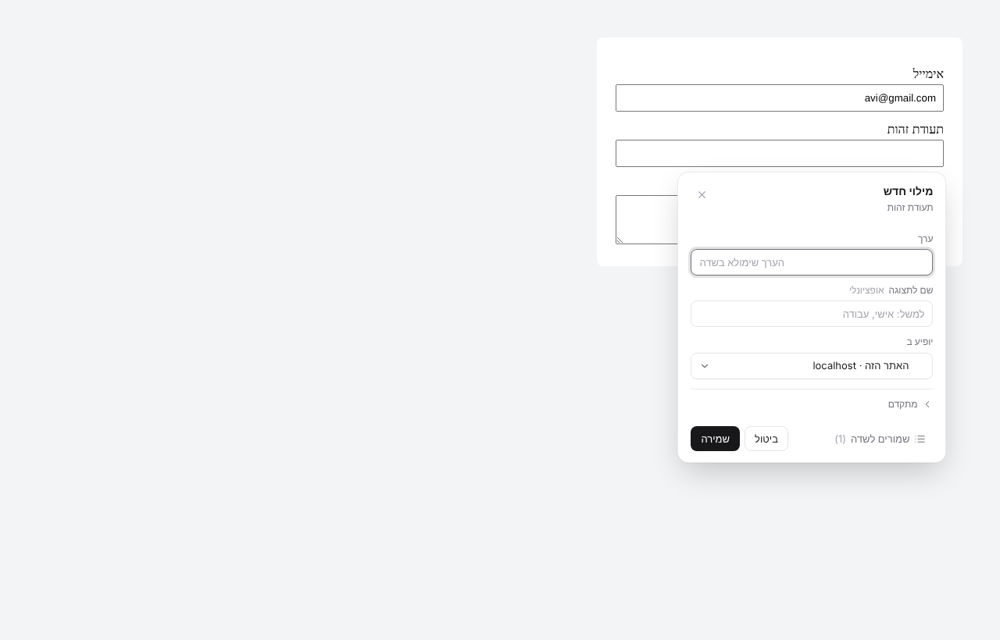 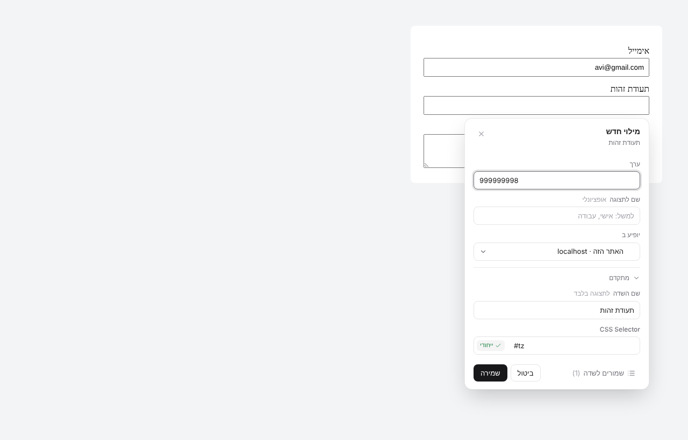 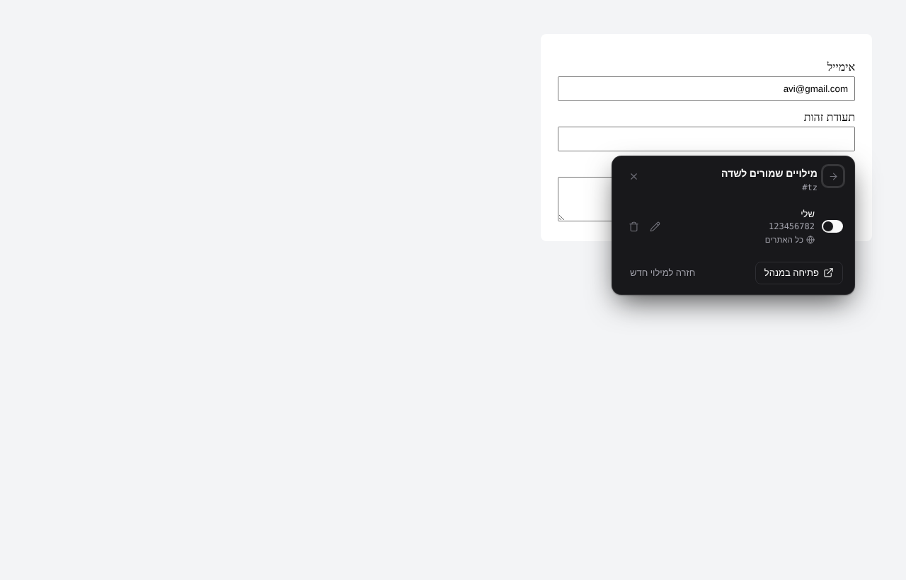

**מיקום:** כרטיס ברוחב 344px שנפתח 6px מתחת לשדה (או מעליו כשאין מקום), נצמד לגבולות המסך ועוקב אחרי גלילה ושינוי גודל.
כשהמסך צר מ-420px, או כשהשדה לא נראה, הכרטיס נפתח באמצע. שכבה שקופה תופסת לחיצה מחוץ לכרטיס וסוגרת אותו (בלי החשכת הדף).
הדף מסומן `inert` כל עוד החלון פתוח, ויש מלכודת focus.

**תצוגת "מילוי חדש":**

| אזור | תוכן |
|------|------|
| כותרת | "מילוי חדש", ומתחת שם השדה (מזוהה אוטומטית); ✕ |
| ערך | שדה עם פוקוס אוטומטי, `dir=auto` |
| שם לתצוגה | עם הסימון "אופציונלי" |
| יופיע ב | `<select>` אחד: **האתר הזה · hostname** (ברירת מחדל) / הדף הזה בלבד (מציג את הכתובת) / כל האתרים / כתובת שמכילה… (פותח שדה תבנית) |
| מתקדם (מקופל) | שם השדה (לתצוגה בלבד); CSS Selector בגופן מונו עם תגית **ייחודי ✓** (ירוק) או **לא ייחודי** (ענבר) |
| תחתית | "שמורים לשדה (N)" · ביטול · **שמירה** |
| מקלדת | Enter שומר, Esc סוגר |

**זיהוי שם השדה:** אם כבר יש מילוי עם אותו selector, לוקחים את ה-`fieldLabel` שלו. אחרת מנסים לפי הסדר:
`<label>` המשויך לשדה → `aria-label` → `placeholder` → `name`. הטקסט מנוקה (רווחים, `*`/`:` בסוף) ומקוצר ל-40 תווים.

**תצוגת "מילויים שמורים לשדה":** מחליפה את תוכן הכרטיס, עם חץ חזרה. מה שכבר הוקלד בטופס ההוספה **נשמר** בזמן המעבר.
כל שורה כוללת מתג פעיל/כבוי, שם וערך, שורת היקף עם אייקון, עריכה במקום (שם + ערך, Enter שומר) ומחיקה בשני שלבים:
לחיצה ראשונה הופכת את הכפתור ל"למחוק?" באדום, לחיצה שנייה מוחקת, ואחרי 3 שניות הכפתור חוזר למצבו.
מילויים שלא חלים על הדף הנוכחי מעומעמים. בתחתית: "פתיחה במנהל" (הודעת `open-manager`) ו"חזרה למילוי חדש". Esc חוזר אחורה.

### 4.3 מסך הניהול

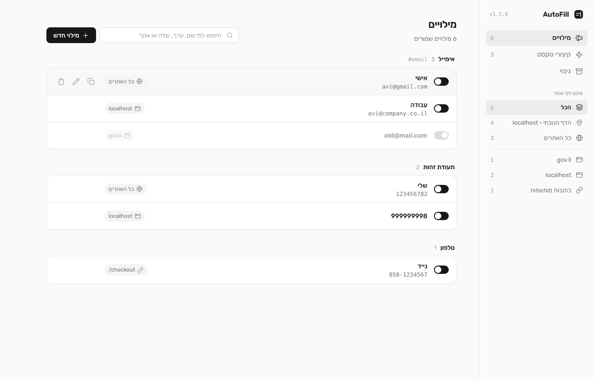

**מבנה:** רשת של שתי עמודות: סרגל צד ברוחב 248px (צמוד לגלילה) ועמודת תוכן ברוחב עד 980px.

**סרגל הצד:**
- לוגו, "AutoFill" ומספר הגרסה (נקרא מה-manifest).
- ניווט: **מילויים** (מונה) · **קיצורי טקסט** (מונה) · **גיבוי**.
- "סינון לפי אתר" (רק בתצוגת המילויים): **הכל** · **הדף הנוכחי · host** (כשהמנהל נפתח מאתר) · **כל האתרים** · קו מפריד · כל דומיין שמור · **כתובות מותאמות** (מילויים מסוג "כתובת מכילה"). ליד כל פריט מוצג מספר המילויים.

**תצוגת מילויים:**
- כותרת "מילויים", ושורת תיאור דינמית ("6 מילויים שמורים" או "2 מתוך 6 מילויים · localhost").
- חיפוש (שם, ערך, שדה, selector, אתר) וכפתור ראשי **＋ מילוי חדש**.
- תגית סינון לפי שדה (כשהגיעו מ"פתיחה במנהל"), עם ✕ לניקוי.
- קבוצות לפי שדה: כותרת = שם השדה ומספר הפריטים. ה-selector הטכני מופיע בצד השני **רק ב-hover**.
- כל קבוצה היא כרטיס, והשורות בה מופרדות בקו. בכל שורה: מתג, שם/ערך, תגית היקף (אייקון וטקסט), ופעולות ב-hover: **העתקה** (האייקון הופך ל-✓ ירוק לשנייה), עריכה, מחיקה (טוסט עם "ביטול" למשך 6 שניות). מילוי כבוי מעומעם.

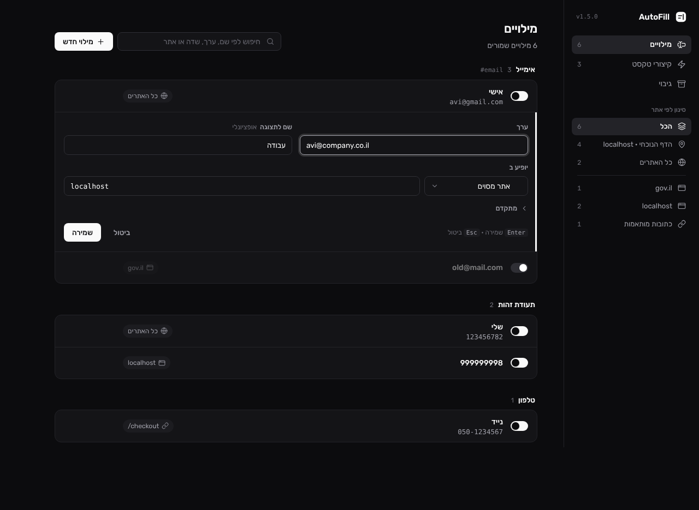 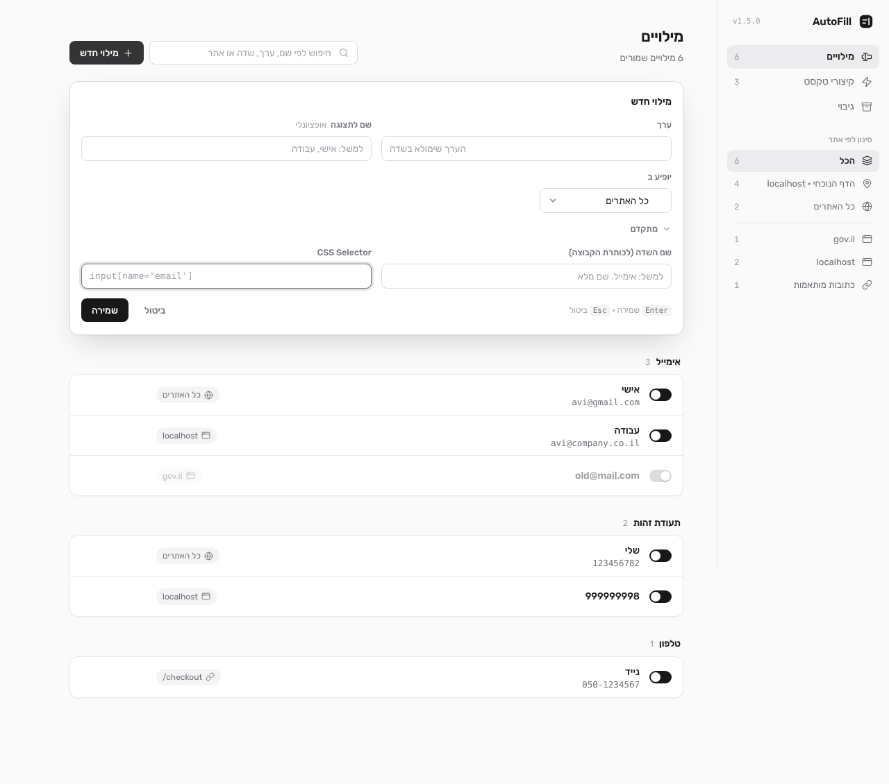

**עורך (בתוך השורה):** שתי עמודות: ערך · שם לתצוגה (אופציונלי); "יופיע ב" = select (כל האתרים / אתר מסוים / כתובת שמכילה…) ושדה ערך שמופיע רק כשצריך.
"מתקדם" כולל את שם השדה ואת ה-selector. בצד ימין של השורה יש פס בצבע ההדגשה, ובתחתית רמז `Enter שמירה · Esc ביטול`.
מילוי חדש נפתח ככרטיס מוגבה בראש הרשימה עם הכותרת "מילוי חדש".

**תצוגת קיצורים:** 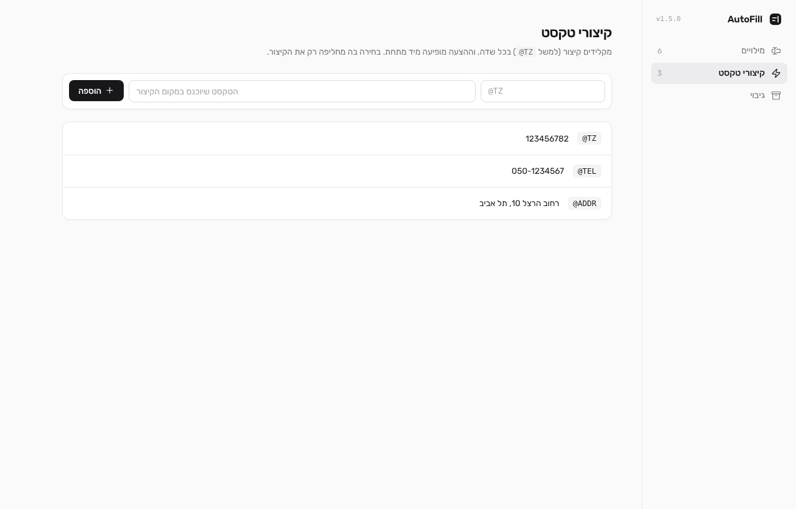
הסבר קצר בכותרת, וכרטיס הוספה בשורה אחת (קיצור במונו · טקסט · ＋ הוספה).
ברשימה: הקיצור כתגית מונו, הטקסט, ופעולות העתקה/עריכה/מחיקה (עם ביטול). העריכה נעשית בתוך השורה.

**תצוגת גיבוי:** 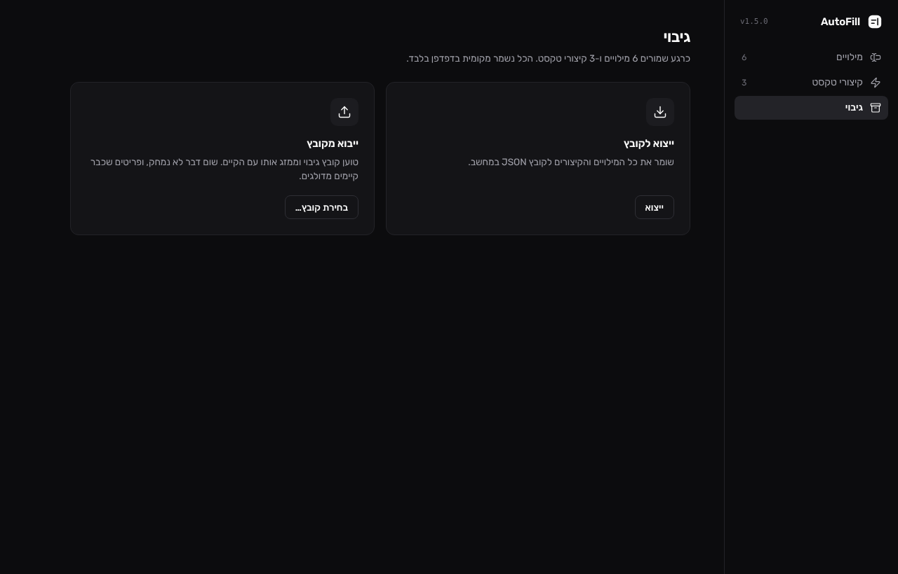
שורת סיכום ("כרגע שמורים X מילויים ו-Y קיצורי טקסט. הכל נשמר מקומית בדפדפן בלבד."), שמתעדכנת חי.
שני כרטיסים: ייצוא לקובץ, וייבוא מקובץ (עם הסבר שהייבוא ממזג ולא מוחק).

**טוסט:** 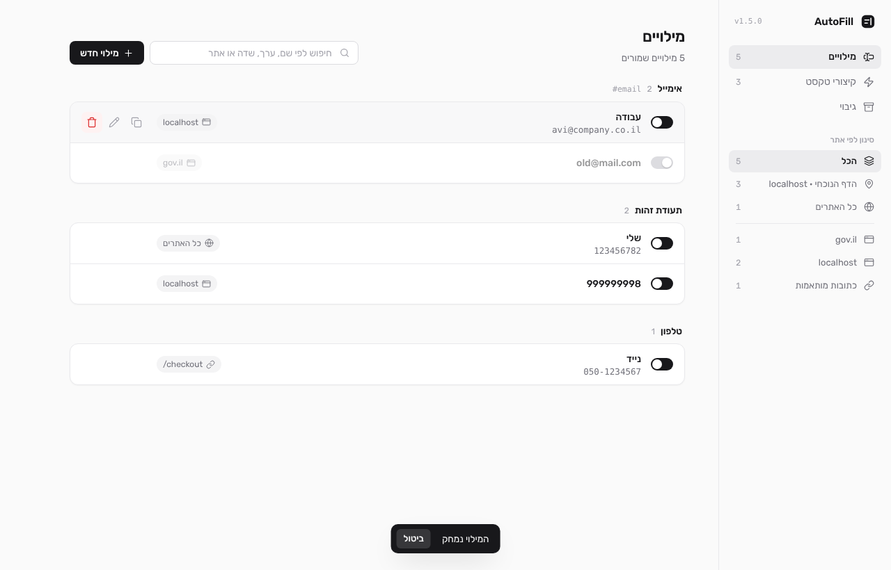 גלולה כהה (בהירה במצב כהה) בתחתית המרכז, עם כפתור "ביטול".

**מסך צר (מתחת ל-820px):** 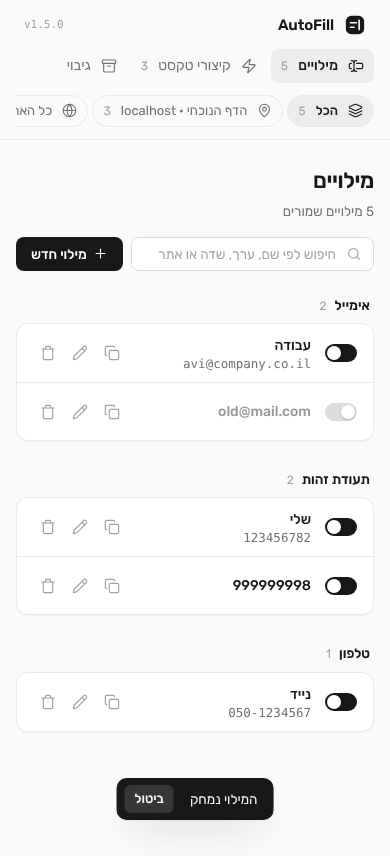 הסרגל הופך לשורה עליונה, והניווט ורשימת האתרים הופכים לשורות "צ'יפים" עם גלילה אופקית.
החיפוש מתרחב לכל הרוחב, הפעולות בשורות גלויות תמיד, תגית ההיקף מוסתרת והעורך עובר לעמודה אחת.

**מסכי ריקנות:** אייקון בריבוע מעוגל, כותרת ושורת הסבר. יש גרסה ל"עדיין אין מילויים" (כולל איך מוסיפים), ל"לא נמצאו מילויים" ול"עדיין אין קיצורים".

---

## 5. שינויי לוגיקה (התנהגות)

אלה השינויים שמשנים **מה התוסף עושה**, לא רק איך הוא נראה. כולם נגזרו מתשובות לשאלות:

| # | שינוי | לפני | אחרי | מקור |
|---|-------|------|------|------|
| L1 | Enter ברשימת ההצעות | Enter בלי סימון עבר לאתר (למשל שלח טופס) | **הפריט הראשון מסומן מראש, ו-Enter ממלא אותו** | שאלה 11 |
| L2 | היקף ברירת מחדל של מילוי חדש מתוך דף | "כל האתרים" | **"האתר הזה" (domain)**. בדף בלי hostname (למשל `file://`) האפשרות לא מוצגת וברירת המחדל היא "הדף הזה בלבד" | שאלה 10 |
| L3 | שם השדה בחלון ההוספה | רק ממילוי קיים עם אותו selector | ממילוי קיים, ואם אין: **ניחוש מהדף** (`label`/`aria-label`/`placeholder`/`name`) | שאלה 10 |
| L4 | מחיקה מתוך החלון שבדף | `confirm()` של הדפדפן | **שני שלבים בתוך הכפתור** | נגזר משאלות 1 ו-14 (בלי חלונות מערכת) |
| L5 | סינון במנהל | צ'יפים: הכל / גלובלי / האתר הנוכחי / select של דומיינים | **רשימה בסרגל**, ועוד סינון חדש: **"כתובות מותאמות"** (url-contains) | שאלות 5 ו-7 |
| L6 | "מילוי חדש" במנהל | תמיד "כל האתרים" | כשמסונן לדומיין או לדף הנוכחי, **ההיקף ממולא מראש לאותו דומיין** | נגזר משאלה 7 |
| L7 | קיצורים במנהל | סקשן מתקפל, מצבו נשמר ב-`af_ui_snippets_open` | **תצוגה נפרדת בסרגל**, והמפתח `af_ui_snippets_open` לא נקרא ולא נכתב יותר (ערך ישן נשאר בלי השפעה) | שאלה 5 |
| L8 | העתקת ערך | לא היה | **כפתור העתקה** למילויים ולקיצורים (`navigator.clipboard`) | שאלה 15 |
| L9 | חזרה מרשימת השמורים | חלון שני מעל הראשון | **תצוגה באותו חלון, והטיוטה נשמרת** | שאלה 14 |

**מה לא השתנה:** סכמת האחסון (`af_entries`, `af_snippets`), ה-API של `__afStorage`, פורמט הגיבוי, חוזה ה-hash של המנהל
(`#url=…&sel=…`), התנהגות האייקון והרשאות ה-manifest.

---

## 6. שינויי קוד לפי קובץ

### קבצים חדשים

| קובץ | תיאור |
|------|-------|
| `content/icons.js` | `window.__afIcons = { svg(name,size), node(name,size) }`. טבלת path קבועה, ולכן בטוח להכניס את התוצאה ל-`innerHTML`. יש בו guard מפני הזרקה כפולה. נטען כ-content script (אחרי `fill.js`, לפני `dropdown.js`) וגם בדף המנהל |
| `manager/fonts/rubik-hebrew.woff2`, `rubik-latin.woff2`, `OFL.txt` | פונט Rubik variable מ-`@fontsource-variable/rubik@5.1.0` (npm), שתי תת-קבוצות, ורישיון |
| `icons/icon-16/32/48/128.png`, `icons/logo.svg` | אייקון התוסף החדש ומקורו |
| `tests/ui-smoke.js`, `tests/fixture.html` | בדיקת UI אוטומטית (§7) ודף טופס לבדיקה |
| `docs/REDESIGN-v1.5.md`, `docs/screenshots/*.png` | המסמך הזה וצילומי המסך שלו |

### קבצים שנמחקו
- `icon.png`, שהוחלף ב-`icons/`.

### `manifest.json`
- `version` מ-1.4.0 ל-**1.5.0**.
- `content/icons.js` נוסף לסדר הטעינה: `storage → selector → fill → icons → dropdown → config-panel → snippet → content`.
- `action.default_icon` ו-`icons` מצביעים על ארבעת הגדלים ב-`icons/`. `default_title` = "AutoFill · ניהול".
- ההרשאות לא השתנו.

### `background.js`
- כותרת התפריט הימני: "AutoFill: הגדר אפשרויות לשדה זה" (בלי ⚡). התפריט נוצר ב-`onInstalled`, ולכן צריך לטעון את התוסף מחדש.

### `content/dropdown.js`
- CSS חדש לגמרי עם משתני צבע מקומיים ומצב כהה.
- המבנה: `.af-drop > .af-list (items) + .af-footer`. כפתור ✕ עבר מפינה צפה אל שורת התחתית.
- `opts.highlight` (חדש): כשה-`name` מתחיל ב-highlight, הוא מוצג כקיצור מונו עם `<b>` על החלק המוקלד.
- `setFocus(0, false)` בסוף `show()`: הפריט הראשון מסומן מראש.
- `setFocus(idx, scroll = true)` גולל את הפריט המסומן לתצוגה (`scrollIntoView({block:'nearest'})`).
- `mousemove` על פריט מזיז את הסימון, ו-`:hover` הוסר כדי שלא יהיו שני סימונים בבת אחת.
- אייקונים דרך `window.__afIcons.node`.
- **לא השתנו:** מיקום ומעקב אחרי השדה, סגירה באובדן focus, `MutationObserver`, בידוד אירועים וניקוי מאזינים.

### `content/config-panel.js` (נכתב מחדש)
- **מבנה:** `show()` יוצר host עם Shadow DOM, שכבה שקופה ו-`.af-pop`. `renderAddView(ctx)` ו-`renderListView(ctx, selector)` מחליפים את תוכן הכרטיס.
  `ctx` מחזיק את `hostname`, `pageUrl` (בלי `#`), ה-selector שנוצר ו-`draft` (הטיוטה בזמן מעבר לרשימה).
- **מיקום:** `position()` + `scheduleReposition()` (מאוחד ב-rAF) על scroll/resize, על שינוי היקף ועל פתיחת "מתקדם". `hide()` מסיר את המאזינים ומבטל את ה-rAF.
- **שמירה:** אותה המרה כמו קודם: `url-full` נשמר כ-`url-contains` + ‏pageUrl. כפתור השמירה מנוטרל בזמן הכתיבה, ואם הכתיבה נכשלת הוא חוזר לפעול.
- **פונקציות עזר:** `guessLabel(el)`, `updateBadge` (עם try/catch ל-selector לא תקין), `describeScope` ו-`h()`/`button()` לבניית DOM בלי `innerHTML` (חוץ מאייקונים).
- **מלכודת focus ו-`inert`:** אותה לוגיקה, ועכשיו היא זוכרת גם `SELECT`/`BUTTON` ולא רק `INPUT`.

### `content/content.js`
- `trySnippet` מעביר `{ suppressAutoHideOnInput: true, highlight: token }`. ההערה על התלויות עודכנה ל-`__afIcons`.

### `manager/manager.html` (נכתב מחדש)
- `.app` = `<aside class="sidebar">` + `<main>`, עם שלושה `<section class="view">`: `view-entries`, `view-snippets`, `view-backup`.
- האייקונים הסטטיים הם `<span data-icon="name" data-size="N">`, ו-`hydrateIcons()` ממלא אותם.
- המזהים שהסקריפטים משתמשים בהם נשמרו כשאפשר (`af-search`, `af-add-btn`, `af-body`, `af-new-slot`, `af-sel-filter`, `af-snippet-form`, `af-snip-trigger`, `af-snip-value`, `af-snippet-list`, `af-export`, `af-import`, `af-import-file`, `af-toast-host`).
  מזהים חדשים: `af-nav`, `af-nav-entries`, `af-nav-snippets`, `af-sites`, `af-sites-section`, `af-version`, `af-backup-stats`. מזהים שהוסרו: `af-chips`, `af-snippets-section`, `af-snip-count`.

### `manager/manager.css` (נכתב מחדש)
- `@font-face` ×2, טוקנים (§3.2), shell, controls (`.btn` primary/secondary/ghost, `.icon-btn`, `.input`, `.search`, `.switch`, `.card`), קבוצות ושורות, עורך, מסכי ריקנות, קיצורים, גיבוי, טוסט, ו-`@media (max-width: 820px)`.

### `manager/dom.js`
- היו: `el`, `scopeBadge`, `showToast`.
- נוספו: `icon`, `hydrateIcons`, `iconButton(name,title,cls)`, `toggle(checked,onChange,label)`, `copyButton(getText)`, `emptyState(icon,title,text)`.
- `scopeBadge` מחזיר תגית עם אייקון, טקסט ו-`title` מסביר. ערך דומיין או כתובת מוצג `dir=ltr`.
- הטוסט מקבל `role="status"`, וכפתור הביטול נקרא "ביטול" (היה "בטל").

### `manager/entry-editor.js`
- הלוגיקה לא השתנתה (שולח רק `{id}` + שדות הטופס; אם המילוי נמחק בינתיים, השמירה רק סוגרת את העורך).
- השינויים הם במבנה ובעיצוב: כותרת "מילוי חדש" למילוי חדש, תווית "אופציונלי", שדה ההיקף מוסתר ב"כל האתרים" (במקום disabled), "מתקדם" עם chevron, ורמז מקלדת.

### `manager/manager.js`
- `state.view` חדש ו-`setView()`. `state.chip` הוחלף ב-`state.site`, שמקבל `'all' | 'global' | 'page' | 'domain' | 'url'`.
- `renderSites()` מחליף את `renderChips()`. `renderNavCounts()`, ו-`renderList()` עם מסכי ריקנות, כרטיס לכל קבוצה וכותרת קבוצה שלוקחת את ה-`fieldLabel` הראשון שאינו ריק.
- `renderNewSlot()` ממלא את ההיקף לפי הסינון (L6) ועוטף את העורך בכרטיס.
- בזמן שעורך פתוח, `chrome.storage.onChanged` מעדכן רק את המונים (לא בונה מחדש את העורך).
- `applyHash()` מחזיר תמיד לתצוגת המילויים.

### `manager/snippets.js`
- `<details>` ו-`af_ui_snippets_open` הוסרו. הרשימה מוצגת ככרטיס, עם מסך ריקנות, כפתור העתקה ומונה בסרגל.
- לוגיקת השמירה, העריכה והביטול לא השתנתה.

### `manager/backup.js`
- נוסף `renderStats()` (מתעדכן ב-`storage.onChanged`). הלוגיקה של ייצוא, ייבוא וניקוי הנתונים לא השתנתה.

### מסמכים
- `CLAUDE.md`, `ARCHITECTURE.md`, `PROJECT_MAP.md`, `AGENT_CONTEXT.md`, `DECISIONS.md`, `DEPENDENCIES.md`, `CHANGELOG.md` עודכנו.

---

## 7. בדיקות

### 7.1 בדיקה אוטומטית (`tests/ui-smoke.js`)

הבדיקה טוענת את התוסף **כ-unpacked אמיתי** ב-Chromium (Playwright, headless חדש), פעמיים: במצב בהיר ובמצב כהה. בכל ריצה:

1. ממלאת את האחסון ב-5 מילויים (global / domain / domain כבוי / url-contains) ו-3 קיצורים.
2. **dropdown:** לחיצה על שדה האימייל, צילום, ואז Enter. בודקת שהשדה מולא ב-`avi@gmail.com` (הפריט הראשון, L1).
3. **קיצור:** הקלדת `שלום @T` ב-textarea, צילום, ואז Enter. בודקת שהתוצאה היא `שלום 123456782` (רק הקיצור הוחלף).
4. **popover:** פתיחה מכפתור "מילוי חדש" שבתחתית ה-dropdown, צילום, הקלדת ערך, פתיחת "מתקדם", מעבר לרשימת השמורים וחזרה.
   בודקת ש**הטיוטה נשמרה**. אחרי שמירה בודקת שהמילוי נשמר עם `matchType: 'domain'`, `matchValue: 'localhost'` (L2) ו-`fieldLabel: 'תעודת זהות'` (L3).
5. **מנהל:** פתיחה עם `#url=…` (סינון לדף הנוכחי), "הכל", hover, עריכה, Esc, מילוי חדש, קיצורים, גיבוי, מחיקה (טוסט), ותצוגת מובייל (390px).
6. בודקת שהפונט Rubik באמת נטען (`document.fonts.check`).
7. אוספת כל `pageerror` ו-`console.error` מהדף ומהמנהל.

**תוצאה בסוף העבודה:** `ALL CHECKS PASSED` (בהיר + כהה), בלי שגיאות JS.

הרצה:
```bash
python3 -m http.server 8765 --directory tests &
PW=$(npm root -g)/playwright node tests/ui-smoke.js /tmp/af-shots
```

### 7.2 בדיקות נוספות
- `node -e "new Function(src)"` על כל קובצי ה-JS (בדיקת תחביר).
- מעבר ידני על כל צילומי המסך (26, בהיר וכהה). שתי בעיות שנמצאו ותוקנו: placeholder בעברית בשדה LTR הוצג מבולגן, ותווית "אופציונלי" הייתה רחוקה מדי מהשדה.

---

## 8. מגבלות ידועות ומה לא נבדק

- **לחיצה ימנית אמיתית על התפריט** לא נבדקה, כי אי אפשר ללחוץ על תפריט מערכת ב-headless. הבדיקה פתחה את החלון מכפתור ה-dropdown. הקוד שמטפל בהודעה `open-config` לא השתנה.
- **Chrome רגיל (לא headless), Windows ו-macOS** לא נבדקו. כדאי לטעון את התוסף מחדש ולעבור על המסכים.
- **אתרים עם Trusted Types / CSP קשוח:** האייקונים נבנים דרך `template.innerHTML` עם תוכן קבוע. ב-isolated world של content script זה אמור לעבוד, ו-`config-panel` הקודם השתמש ב-`innerHTML` באותו אופן, אבל זה לא נבדק על אתר כזה.
- **`↑↓` ברמז המקלדת** מוצג בסדר הפוך (`↓↑`) בגלל כיוון RTL. זה קוסמטי בלבד.
- **החשכת הדף:** הפופאובר לא מחשיך את הדף, אבל הדף עדיין `inert` (אי אפשר להקליד בו), ולחיצה מחוץ לחלון סוגרת אותו. ערך שהוקלד ולא נשמר הולך לאיבוד, כמו בגרסה הקודמת.
- **מתג במצב כהה:** הכדור במצב דלוק מקבל את צבע הרקע, כדי שיהיה ניגוד על מסלול לבן.
- **הגבלות קיימות** (selectors שבירים, Shadow DOM של אתרים, קיצורים בשדות email/number וכו') לא השתנו. ראה `CLAUDE.md` › What's NOT supported.

---

## 9. מדריך תחזוקה: איך משנים

| רוצים לשנות | איפה |
|-------------|------|
| צבע הדגשה / פלטה | `manager/manager.css` `:root` (+ הבלוק הכהה), ובמקביל משתני `.af-drop` ב-`content/dropdown.js` ו-`.af-pop` ב-`content/config-panel.js` |
| להוסיף אייקון | להוסיף מפתח ל-`PATHS` ב-`content/icons.js` (path בגריד 24×24) ולהשתמש ב-`icon('name')` / `data-icon="name"` |
| לבטל את הסימון המוקדם ב-dropdown (L1) | למחוק את `setFocus(0, false);` ב-`content/dropdown.js` |
| להחזיר "כל האתרים" כברירת מחדל (L2) | `content/config-panel.js` › `renderAddView`: `scopeSel.value = d.scope \|\| 'global'` |
| להסתיר את המונים ליד אתרים | `manager.css`: `.site-count { display: none; }` |
| להסיר את מסכי הריקנות המעוצבים | `manager/manager.js` › `renderList` / `manager/snippets.js` › `render`: להחליף את `emptyState(...)` בטקסט פשוט |
| נקודת המעבר למובייל | `@media (max-width: 820px)` בסוף `manager.css` |
| לרנדר את האייקון מחדש | לערוך את `icons/logo.svg`, ולרנדר ב-Chromium (`page.screenshot({omitBackground:true})`) ל-16/32/48/128 |

**אחרי כל שינוי:** `chrome://extensions` → Reload לתוסף, ולרענן את הדפים הפתוחים (content scripts ישנים לא מתעדכנים לבד).
